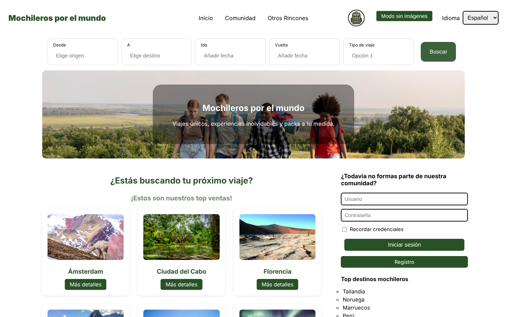
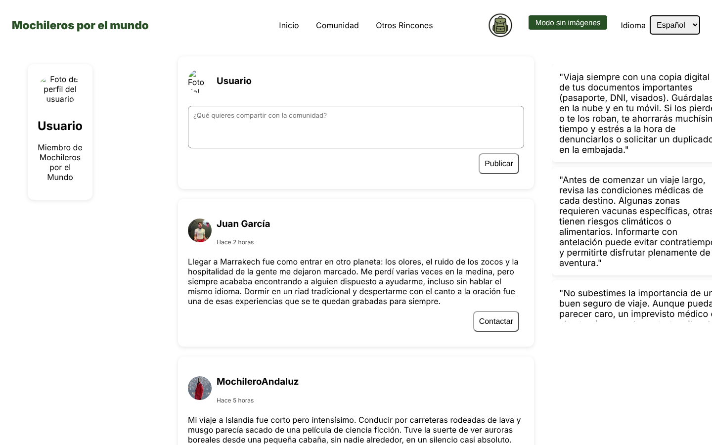
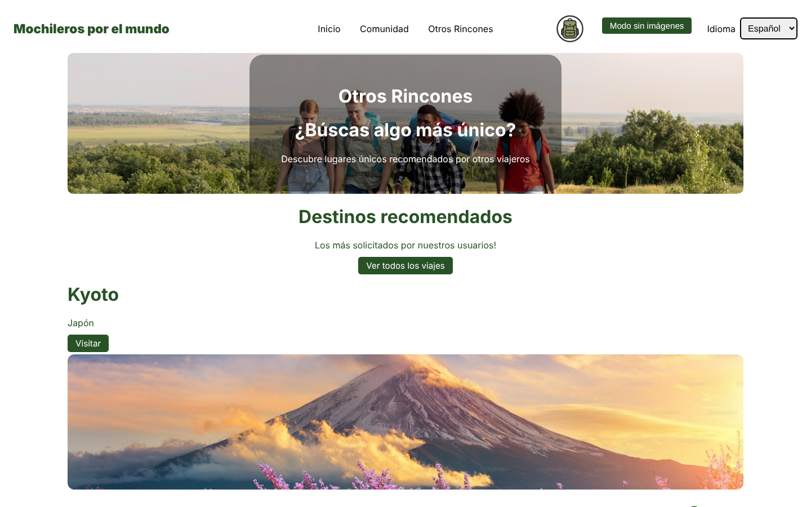
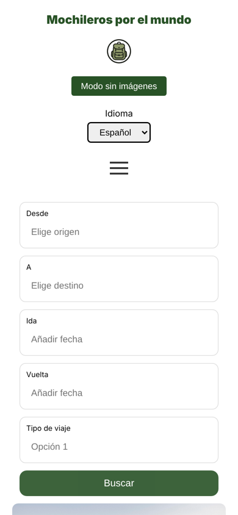

# Mochileros por el mundo

A travel community website for backpackers. Users can search for and book trips, explore destinations by continent, share their experiences in a community forum and contact other travellers. It is built with plain HTML, CSS and JavaScript, with no frameworks or libraries.

Built for the User Interfaces course at Universidad Carlos III de Madrid (2025).

**[Live demo →](https://lucasruizgomez.github.io/ux-travel-community-web/src/home.html)**



## Features

- **Trip search**: pick origin, destination, dates and trip type
- **Destinations by continent**: loaded from a JSON dataset of countries and cities, with a booking flow for each city
- **Checkout form with traveller needs**: options for pets, lactose intolerance and allergies
- **User accounts**: registration, login, logout and a personal profile page
- **Community forum**: users publish their travel stories and contact the authors
- **Favourites**: users save trips to a personal list
- **Language switcher**: Spanish, English and French
- **No-images mode**: hides all images for slow or limited connections
- **Responsive design**: works on desktop, tablet and mobile, with a hamburger menu on small screens

| Community | Destinations | Mobile |
|---|---|---|
|  |  |  |

## How it works

- **No backend.** Sessions, posts, favourites and language preference are stored in `localStorage` and `sessionStorage`, so user data never leaves the browser.
- **Adapted MVC.** HTML and CSS are the view, `script.js` is the controller, and browser storage is the model.
- **Event-driven.** Components listen for user events (`addEventListener`) instead of calling each other directly, which keeps them decoupled.

## Accessibility and usability

- **0 errors in WAVE** on every page, with semantic HTML, alt text, labelled forms and full keyboard navigation
- **Valid HTML** according to the W3C validator
- **Above the SUS benchmark of 68** in usability testing with another student group
- Designed around Nielsen's usability heuristics and user personas, from a Figma prototype

## Tech stack

HTML5 · CSS3 (Grid, Flexbox, media queries) · JavaScript (vanilla) · Figma · WAVE · W3C Validator

## Run it locally

The destinations page loads a JSON file, so it needs a local server rather than opening the files directly:

```bash
cd src
python -m http.server 8000
```

Then open `http://localhost:8000/home.html`.

## Project structure

```
src/
├── home.html                          Landing page and trip search
├── comunidad.html                     Community forum
├── otros_rincones.html                Recommended destinations
├── pagina_viajes.html                 Trips by destination
├── pagina_viajes_personalizados.html  Custom trip page
├── formulario_compra.html             Checkout form
├── usuario_registrado.html            Home for logged-in users
├── perfil.html                        User profile
├── a.html                             Registration
├── ciudades-del-mundo.json            Countries and cities dataset
├── script/script.js                   Application logic
└── styles/styles.css                  Styles
doc.pdf                                Project report (Spanish)
```

## Team

Lucas Ruiz Gómez · Malena Lozano Alonso · Javier Pastor Peñalba · Paloma González Valdelomar

**My contributions:** search and country pages, the community section, the favourites system, user profile and logout, the no-images mode and messaging, the responsive layout, and the final pass that fixed all HTML validation and WAVE accessibility errors.
